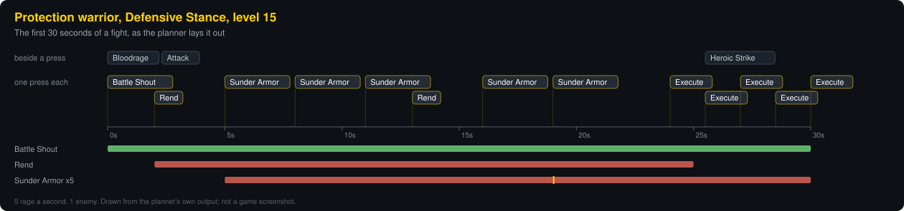
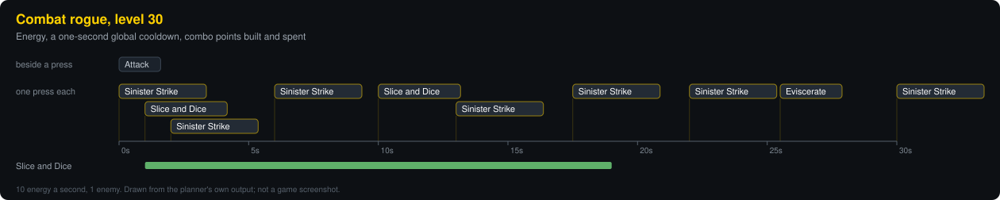
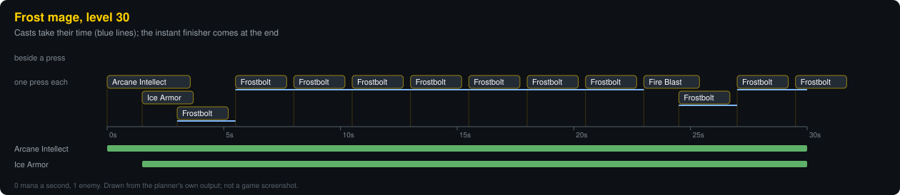
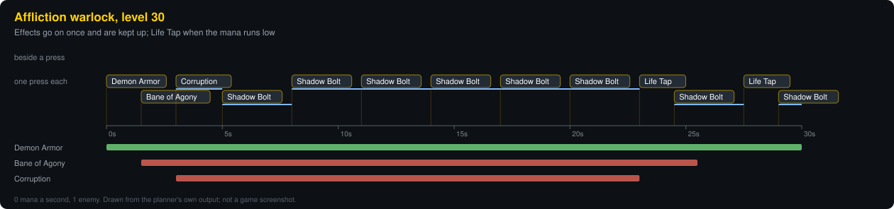
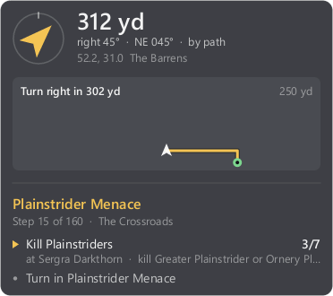

<h1 align="center">polestar-plus</h1>

<p align="center">
  <b>A read-only companion for World of Warcraft: Forever.</b><br>
  What to press next, planned in time, and a rotation designer to make it yours.<br>
  Plus your Polestar guide, quest and arrow in a terminal, a JSON stream or a click-through overlay.
</p>

<p align="center">
  <a href="https://github.com/dougwithseismic/polestar-plus/actions/workflows/ci.yml"></a>
  
  
  
</p>

<p align="center">
  
</p>

## What is in it

| | What it is | Where it runs |
| --- | --- | --- |
| **Polestar Next** | Shows the ability to use now, the next few after it laid out in time, and a designer for the rotation behind them. All nine classes, a rotation for each talent tree and stance. | In the game, as an add-on |
| **PolestarLink** + `polestar-plus` | Reads what the Polestar leveling add-on is showing (guide, step, quest, goals, arrow, walking path) out of the game window. | A small add-on, and a Rust program beside the game |
| **The overlay** | A click-through panel over the game: the arrow, the distance, the path ahead and the current goal. | A window of its own, on top of the game |

## It only shows

This project reads and draws. It does not play.

- The add-ons use the game's add-on API and nothing else. They have no way to cast, target, move or press a key, and a test fails the build if a call that could is ever written into them.
- The Rust program copies pixels from the game window, as a screenshot does. It never opens the game's process, never reads its memory and never sends it input.
- What to press next stays inside the game. It is not on the strip the reader reads, not in the JSON, and not on the overlay.

## Quick start

Windows, with [Rust](https://rustup.rs) installed:

```powershell
git clone https://github.com/dougwithseismic/polestar-plus
cd polestar-plus
cargo build --release
.\target\release\polestar-plus.exe install    # copies both add-ons into the game
```

Restart the game (a new add-on needs a full restart; an update only needs `/reload`). Then:

- `/pnext` shows the panel, `/pnext edit` opens the designer, `/pnext options` the settings.
- `.\target\release\polestar-plus.exe` is the live terminal view; `overlay` is the panel over the game.

The reader needs the Polestar add-on installed; Polestar Next works without it.

## Polestar Next

**A plan, not just a priority list.** The add-on tracks each effect it maintains, each cooldown, the global cooldown and how fast the rage, energy or mana is coming in. Then it steps forward one press at a time, in a future where its own earlier presses have happened. A bleed goes back on in the last slot before it drops. A strike is placed where its cooldown ends. A spell with a cast holds its slot for the cast.

<p align="center">
  
  
  
</p>

<p align="center"><sub>These are drawn from the planner's own output in the test harness. They are what the designer's preview shows, not screenshots of the game.</sub></p>

**What you get in the game**

- **The panel**: the ability to use now, large, with its key; the next few beside it, each sliding along and growing into the big one as its turn comes. A shade over the big icon draws up as the global cooldown runs out.
- **The glow**: the same ability's own button lights up on your bars. Gold for now, red when it only needs you in range, blue when it is waiting on rage, energy or mana.
- **A rotation that follows the character**: built from your spellbook, talents, gear and stance, reordered by the damage the game says each ability does for you, and rebuilt within a second or two of a respec or a new weapon.
- **Written for Forever, not Classic Era**: Victory Rush, Holy Strike, Ice Lance on Fingers of Frost, Wrack, Primal Bite, Maelstrom Weapon and the rest, with Tiger's Fury gone. [What changed for each class.](docs/polestar-next.md#rotations-written-for-forever)

**The designer** (`/pnext edit`)

- Drag abilities to reorder them, switch one off without losing it, duplicate one, pick spells from a list with their icons.
- Build conditions from tests joined by ALL, ANY and NOT, or pick from ready-made ones ("keep it on the target", "an opener", "to finish").
- Every rule is said back in plain words:

  ```text
  Use Sunder Armor when you are fighting something and either it is stacked fewer than 5 times or it has under 4.5 seconds left.
  Use Rend when you are fighting something, it is not on the target and the target's health is 35% or more (as far as the game shows).
  Use Heroic Strike when you are fighting something and rage is 30 or more. It is switched on once and left on.
  ```

- A timeline along the bottom plays the rotation out for the first 30 seconds of a fight, and redraws with every change.
- Undo and redo for everything. Update takes in what a newer version of the add-on has learned, and keeps your order.

**Share strings.** A rotation goes out as a string and comes back in, for the class, tree and stance it was made for:

```text
PNR1:W04xO1M3OldBUlJJT1JOMztOMjtTMjg6UHJvdGVjdGlvbiwgRGVmZW5zaXZlIFN0YW5jZVtbTjY2NzM7UzEyOkJhdHRsZ...:d27f
```

Reading one never runs anything. It is parsed as data within limits on its size and depth, checked rule by rule, and only then kept.

[Everything about Polestar Next: how it decides, the planner, the designer, every command.](docs/polestar-next.md)

## The reader and the overlay



PolestarLink calls Polestar's own getters and paints the answer as a thin strip of coloured cells along the top edge of the game window. `polestar-plus` copies that strip from the screen and decodes it.

```text
Guide   The Barrens   40/163 done (25%)
Step    15 of 160   The Crossroads
Quest   Plainstrider Menace  [844]
Goals
    ✓ Accept Plainstrider Menace
  ▶ • Kill Plainstriders  3/7
    · Turn in Plainstrider Menace

Arrow   ↗  on the way  ·  turn right 45°  ·  312 yd along the path
Route   Turn right in 302 yd
```

| Command | What it does |
| --- | --- |
| `watch` (default) | live view in the terminal |
| `once` | print the current state once |
| `json` | one JSON object a line, each time something changes |
| `overlay` | the click-through panel over the game |
| `doctor` | check the window, the capture and the add-on |
| `install` | copy the add-ons into the game |

<br clear="right">

[How the strip works, the overlay's options, and everything it reports.](docs/reader.md)

## What the game hides

In a fight, Forever 1.60.1 keeps the player's rage and health and the target's health from add-ons. Polestar Next works with what is left:

- The game still says, ability by ability, whether there is enough rage for it. One costing 15 that can be used proves at least 15; one costing 20 that cannot proves under 20.
- A check that only guards a margin ("my health is high enough") reads as passed when the number is hidden. A "you are low" rule never does.
- The game has an assistant of its own that knows what it hides. The panel can show its pick beside its own, and `/pnext assist` says how to use it.

## Where it stands

Plainly, so you know what you are installing:

- **Tried in the real game**: the reader, the strip and the overlay; the panel, its menu, the glow and the animated row, on a level 15 Protection warrior.
- **Tested only in a stand-in game so far**: the designer's newer parts (spell picker, undo, timeline, share strings, ready-made conditions), the options window, and every class other than warrior. The stand-in runs the real add-on code against a Lua model of the game's API, with spell figures written from guides, not read from the client.
- **The rotations** follow Blizzard's class notes for Warrior, Priest, Hunter and Druid, and community guides (Method, Warcraft Tavern, wowtbc.gg) for the rest. They are a reasoned order plus the game's own numbers, not a simulation.
- **English clients**: spell descriptions are read in English. On another language the built order still stands, without the numbers.

Screenshots and a clip from the game are on their way.

## Tests

```powershell
cargo test
pip install lupa
python tests/addon_strip.py    # the real PolestarLink add-on in a stand-in game, read back by the real binary
python tests/next_addon.py     # the real Polestar Next add-on in a stand-in game: 26 groups
python tools/make_media.py     # redraw the pictures in docs/media from the code
```

## Not affiliated

This is a fan project. It is not made, endorsed or supported by Blizzard Entertainment or by the authors of Polestar. World of Warcraft is a trademark of Blizzard Entertainment. Polestar is its authors' own work and is not included here; get it from where they publish it.

## Licence

[GPL-3.0](LICENSE), the same licence as Polestar.
