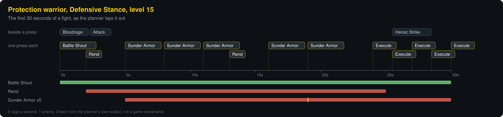

# Polestar Next: which ability to use next

`addon/PolestarNext` is a second add-on, installed by the same `install`. It
shows an icon with the ability to use next and the key it is bound to, inside
the game's own UI. It only shows: it has no way to cast, target or press
anything, and nothing about the suggestion leaves the game (it is not on the
strip, in the JSON, or on the overlay).

## How it decides

1. **Scan.** Class, level, spellbook, action bars and their key bindings,
   talents (points per tree and each talent's ranks) and gear (two-hander,
   two weapons, shield, dagger, wand, ranged weapon).
2. **The class's list.** An ordered list of rules for the class, shaped by the
   scan: which seal a paladin uses, which filler a mage casts, when a
   warrior's spare rage becomes a Heroic Strike, whether Rend is worth it.
   Each rule is a spell and a condition tree of AND / OR / NOT over tests
   (target, in combat, effect missing, rage or mana, health, combo points,
   form, moving, target casting...).
3. **The game's numbers.** The damage abilities are then reordered by what the
   client says they do for this character: cost, cast time, and the damage in
   each spell's description, with the character's weapon damage. Rage and
   energy classes are ordered by damage per point, mana classes by damage per
   second of casting.
4. **This moment.** The first rule down the list fires whose spell is known,
   whose condition holds, and which the game does not report as unusable, on
   cooldown or out of range.

## What the client hides, and what the add-on does about it

In a fight, Forever
1.60.1 hides the player's rage and health and the target's health from
add-ons (seen in the add-on's own report from real fights).

- Rage: the game still says, ability by ability, whether there is enough for
  it. An ability costing 15 that can be used proves at least 15; one costing 20
  that cannot, for want of rage, proves under 20. Rules about rage are answered
  from that, and the panel shows it as "rage ~15-19".
- Health: a check that the player's health is high enough is a safety margin
  and is waived when the health cannot be read. A "you are low" rule is not: an
  unknown health never brings up a heal.
- Cooldowns: where the game will not say, the add-on goes by the casts it saw
  and how long the cooldown runs.
- Enemies in reach are counted by nameplate unit ("nameplate1" upwards).

## The game's own assistant

The game has an assistant of its own (C_AssistedCombat): it picks the next
spell itself, knowing what it hides from add-ons, and has a one-button spell
that casts its pick. `/pnext assist` names that button and says how to use it.
The panel can show the game's pick, teal-edged: when its own rotation has
nothing for now (the default), always, or never (`/pnext assist always`,
`fallback`, `off`, or the panel's menu).

## Limits, plainly

In short: this is a reasoned order plus the game's own numbers, not a
simulation; chance effects, armour and resists are not modelled. Descriptions
are read in English only (otherwise the class's order stands). Where the
client keeps a value secret in combat the add-on treats it as unknown and
never as yes; for effects it cannot see, it goes by the casts it saw you make.

## A rotation for each tree and stance

There is a rotation for each talent tree and stance or form, and the one that
matches the character is in use: a Protection warrior in Defensive Stance opens
with Bloodrage and keeps Sunder Armor up, an Arms warrior in Battle Stance
opens with Charge, Berserker Stance opens with Intercept. It follows the
character live. The rotation is rebuilt when the game announces a change to
spells, talents, gear, level, pet or stance, and once a second the add-on
compares a fingerprint (level, each talent's ranks, spellbook size, weapons,
stance) so a change it was not told about still lands within a second or two.

## The panel and the plan

The panel shows the ability to use now large, with its key, and beside it a
row of the presses after it (four by default; `/pnext next 6`, or the panel's
menu, changes it). The row is a plan, laid out in time. The add-on keeps track
of each effect it maintains (its time left and its stacks), each cooldown, the
global cooldown, and the rage, energy or mana with how fast it is coming in.
From the moment the global cooldown ends it steps forward a press at a time
and asks the rotation what to use at each step, in a future where its own
earlier steps have happened. So a bleed goes back on in the last slot before
it would drop rather than after, Sunder Armor is renewed before it fades, a
strike is placed where its cooldown ends, an ability that needs fifteen rage
is placed where the fifteen will have arrived, and whatever fits goes in the
gaps. Abilities off the global cooldown (a strike queued for the next swing,
Bloodrage) are planned beside a press, not instead of one. A press the plan
had to leave a gap before carries its seconds, counting down.

When the big one is used, the next one's own icon slides across and grows into
its place, the rest shuffle along, and a new one comes in from the right.
Under the icons: the ability's name and why; then what is being tracked, such
as "Rend 4s   Sunder Armor x5 22s   rage 55 +4/s" (a timer the add-on is
estimating, because the game will not show it, has a ~ before it); then the
rotation in use and how many enemies are in reach.

How long an effect lasts is taken from the game whenever it shows the effect,
else from the spell's own description, else from the rotation's rough figure.
Where the game hides the rage, nothing that depends on counting it is planned.

When nothing can be used, the big icon is dimmed and says why: "move into
range", "not enough rage yet" or "ready in 3 s". `/pnext compact` shows the
icons alone.

## The glow on your bars

The suggested ability's own button also glows on the action bars: gold when
it is the one to use now, red when it only needs you in range, blue when it is
waiting on rage, energy or mana. The glow is drawn over the button and does
nothing else; you press or click the button as always. `/pnext glow` turns it
on and off, and `/pnext panel` puts the panel away while the glow stays.

## Enemies in reach

The add-on counts the enemies in reach from their nameplates (the ones that
can be attacked, are alive, and are in range of one of the class's melee
abilities, or on its threat list for a class without one), and the area
abilities follow the count: with two or more, a warrior gets Sweeping Strikes,
Thunder Clap, Whirlwind and Cleave in place of Heroic Strike; with three, a
tank's Demoralizing Shout. This needs enemy nameplates switched on in the
game; `/pnext list` says so when they are off.

## The panel's menu

Click the panel, with either button, for its menu: edit the rotations, print
the rotation in chat, lock or unlock, icon only, bigger and smaller, back to
the middle, hide. The click opens that menu and nothing else; the panel cannot
cast. While it is invisible (locked, with nothing to suggest) it lets the
mouse through.

## Rotations written for Forever

The built rotations are for **World of Warcraft: Forever** (1.60.1), which is
Classic reworked, not Classic Era. They follow Blizzard's class notes
(Warrior, Priest, Hunter, Druid) and the guides written for Forever (Method,
Warcraft Tavern, wowtbc.gg) where it differs:

- **Warrior**: Victory Rush after a kill; Shield Block whenever it is up, with
  a shield; Thunder Clap, Demoralizing Shout and more Sunder Armor on elites;
  Charge from Defensive Stance with Vanguard; Slam with Improved Slam;
  Heroic Strike from 40 rage for a tank and 60 for Arms and Fury once there
  is a main strike.
- **Paladin**: Holy Strike, Seal of Fury for a tank, Swift Judgement.
- **Hunter**: Aimed Shot opens and shares its cooldown with Multi-Shot;
  Sniper Shot, Summon Hawk, Strider Kick.
- **Rogue**: Shank when the energy is low, Death Mark, Subtlety's Rupture.
- **Priest**: Shadow Word: Death; Vampiric Embrace as the short effect it now is.
- **Mage**: Ice Lance on Fingers of Frost, Pyroblast at three Heating Up,
  Arcane Missiles on Missile Barrage, Arcane Wrath, Frostfire Bolt.
- **Warlock**: banes (Agony, Doom) in place of the damaging curses, the
  Nightfall proc, Wrack, Incinerate, Soul Fire with Decimation.
- **Shaman**: Lightning Bolt at five Maelstrom Weapon, Fire Nova.
- **Druid**: no Tiger's Fury (Shifting Power instead), Primal Bite and
  Lacerate for a bear, Faerie Fire in form, Shred on Omen of Clarity, Eclipse.

Procs are read two ways, for the editor too: "the game lights up the button
of" a spell, and "I have a stack or more of" an effect. Paladin, Shaman,
Rogue, Mage and Warlock have no Blizzard class notes to go by, so their new
abilities rest on community guides; what a guide does not say (whether
Judgement still uses the seal up, whether the shocks still share a cooldown)
is assumed to be as in Classic. Left out for want of a safe way to read them:
Improved Scorch stacking, totems, and which curse a raid wants.

## The global cooldown and the options

While the global cooldown runs, or a cast of yours, a shade lies over the big
icon and draws up from the bottom as the next press comes due: when it is
gone, press. `/pnext gcd` switches it off and on.

`/pnext options` (or "Options..." in the panel's menu) opens a window with
every setting in one place: show or hide the panel, lock it, icons only, the
global cooldown on the big icon, the tracking line, size, opacity, how many
are shown coming up, back to the middle; the glow on your bars, alone or with
the panel; when the game's own pick is shown; and the way into the editor.

## The rotation designer

`/pnext edit` opens the editor. Pick a rotation by tree and stance (it opens on
the one in use), drag abilities to reorder them, add or remove them, and build
each one's condition from tests chosen from a menu and joined by ALL-of, ANY-of
and NOT. Each ability shows what it is doing this moment (now, on cooldown,
condition not met...). The first edit to a rotation makes that rotation yours:
it is used exactly as you leave it, and neither the numbers nor a respec
reorder it. "Use the built one" goes back.

In the editor:

- **Add an ability...** opens a picker: your spells with their icons, narrowed
  as you type. A click adds one under the selected ability; Enter adds the
  first shown, or what you typed when nothing matches (a spell you have not
  learned yet).
- The square at the left of each ability **switches it off**: it is passed
  over, and keeps its place and its condition for when you want it back.
- **Duplicate** puts a second copy under the first, to use one spell under two
  conditions.
- **Undo** and **Redo** cover every change, back to the built rotation: moving,
  adding, removing, switching, conditions, an import, "Use the built one". Each
  rotation has its own history, kept until you log out or reload.
- **Update** appears when a rotation of yours is behind the built one: a
  better condition for an ability you have not changed yourself, an ability
  new to the built rotation (it goes in just above the one it comes before
  there), or one the built rotation no longer has. It keeps your order, your
  switches, everything you added or changed, and leaves out what you took
  out yourself. `/pnext update` does the same for the rotation in use, and
  the chat says once at login when there is something to take in. A rotation
  taken in from a string is never touched.

Above an ability's tests the editor says its condition **in plain words**:
"Use Sunder Armor when you are fighting something and either it is stacked
fewer than 5 times or it has under 4.5 seconds left." A NOT is never left to
be read as one ("you are standing still", not "not moving"), and a check
that passes when the game hides the number says so ("as far as the game
shows").

**Ready-made conditions...** lists the usual reasons for a place in a
rotation, to pick instead of building them test by test: in a fight, an
opener, keep it on the target, keep it on me, stack it to five, rage or
energy to spare, mana in reserve, two or three enemies, one enemy only, to
finish, not on a dying target, when hurt, to interrupt, at five combo
points, standing still, on an elite. One is added to what the ability asks
already, leaving out what is there; "Start again" replaces it. Undo takes
it back.

## The timeline preview



Along the bottom of the editor is a **preview**: the rotation you are looking
at, played out on paper for the first 30 seconds of a fight that starts now.
Time runs left to right. The big icons are the presses, one a global cooldown;
the small ones above are what goes beside a press without taking its place
(Bloodrage, Heroic Strike); the bars under the line are the effects the
rotation keeps up, with a gold mark where a stack reaches the top. Point at an
icon for when it comes, what it leaves in the bar and why it is there; click
it to go to that ability. It redraws with every change you make.

The fight on paper is against a new enemy at full health and in reach, with
nothing of yours on it and everything off cooldown; your own buffs are as they
stand. Two things are yours to set: how many enemies there are, and how fast
the bar fills (rage starts empty at 5 a second, energy full at 10). Reactions
(Revenge, Overpower) are left out, since nothing has been dodged or blocked
yet, and a rotation for another stance is played in that stance. The rage an
ability gives at once (Bloodrage, Charge) is read from its description and
counted, in the preview and in the live plan alike.

## What the planner knows about each class

The plan, live and on paper, knows each class's ways:

- **Casts and channels** take their time: a Frostbolt holds its slot for its
  cast, Mind Flay for its three seconds, and what a cast puts on lands when
  the cast ends. On the timeline a blue line runs for as long as it takes.
- **Combo points** are counted: builders add theirs, a finishing move spends
  them, so a finisher is planned for the press after the fifth point.
- **Energy** comes in at ten a second whether or not the add-on has just seen
  it; **mana** goes down with each spell, and the "mana is at least" checks
  follow it. Where the game hides the bar in a fight, what it still says can
  be cast pins it down, and mana kept in reserve reads as a margin, so a
  caster's rotation does not go quiet.
- A paladin's **Judgement uses the seal up** (the seal goes straight back
  on); a shaman's **shocks share a cooldown**; a wand's Shoot is for when
  nothing above it fits, not beside the casts.
- On paper the enemy goes from full health to dead over the 30 seconds, so
  Execute, Hammer of Wrath and "finish it" rules have their moment at the
  end, and a dying enemy is not given a fresh curse. A druid's Cat Form
  rotation is played in Cat Form on energy; a hunter's is fought at range.

## Sharing rotations

Rotations can be shared. "Share" in the editor (or `/pnext share`) gives the
rotation shown as a string, selected and ready for Ctrl+C; "Import" (or
`/pnext import`) takes one in. A string says which class, talent tree and
stance it is for, and goes in as that rotation, so a friend's Fury, Berserker
Stance rotation does not overwrite your Protection one; "Import into the one
shown" puts it where you are looking instead. What an import replaces is kept,
and `/pnext restore` brings it back.

A string looks like `PNR1:W04xO1M3...:a3f1`: the rotation as plain data in a
small notation of its own, in letters that survive being pasted anywhere, with
a check that catches one cut short or mangled. Reading one never runs
anything. It is taken apart piece by piece within limits on its size and
depth, then checked (the class, every test it uses, the shape of every rule),
and only then kept; words in it are stripped of the game's mark-up before they
are shown. A rotation for another class is refused.

## Commands

`/pnext list` prints the list with each rule's condition and numbers and says
what it was built for. `/pnext lock`, `unlock`, `scale 1.2`, `reset` place the
icon; `/pnext` turns it on and off.

| Command | What it does |
| --- | --- |
| `/pnext` | show or hide the panel |
| `/pnext options` | the options window |
| `/pnext edit` | the rotation designer |
| `/pnext list` | print the rotation in use, with each rule's condition |
| `/pnext update` | bring your own version of the rotation up to date with the built one |
| `/pnext share`, `/pnext import`, `/pnext restore` | a rotation as a string, take one in, put back what an import replaced |
| `/pnext assist [always, fallback, off]` | the game's own assistant, and when its pick is shown |
| `/pnext next 4` | how many presses are shown coming up (0 to 6) |
| `/pnext glow`, `/pnext gcd`, `/pnext compact`, `/pnext panel` | the glow on your bars, the cooldown shade, icons only, panel away |
| `/pnext lock`, `/pnext unlock`, `/pnext scale 1.2`, `/pnext reset` | place and size the panel |

## Tests

```powershell
python tests/next_addon.py   # the real add-on in a stand-in game; needs lupa
```
