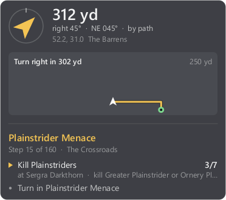

# The reader and the overlay

`polestar-plus` reads what the Polestar leveling add-on is showing
(guide, step, quest, goals, arrow, walking path) out of the game window, for a
terminal, a JSON stream or a click-through overlay. It never opens the game's
process and never sends the game any input.

## How it works

- `addon/PolestarLink` is a small add-on that calls Polestar's own getters and
  paints the result as a thin strip of coloured cells (750 x 6 px) along the top
  edge of the game window. `/plk` toggles it.
- `polestar-plus` finds the game window, copies that strip from the screen and
  decodes it.


The strip is 250 cells by 2, each 3 pixels square. The first cells are fixed
marks the reader looks for; then come the grid's size and version, a sequence
number and length, and a Fletcher-16 check, followed by the payload as tagged
fields (a tag byte, a length byte, the bytes). A frame that fails its check is
dropped, so a half-drawn strip is never read as data. Where the game keeps a
value from add-ons (it does, for some, in a fight) the field is simply left out.

## Use

```powershell
cargo build --release
.\target\release\polestar-plus.exe install   # then restart the game (or /reload after an update)
.\target\release\polestar-plus.exe           # live view
```

| Command | What it does |
| --- | --- |
| `watch` (default) | live view in the terminal |
| `once` | print the current state once |
| `json` | one JSON object a line, each time something changes (`--once` for one) |
| `overlay` | a click-through panel over the game: arrow, distance, quest and goals |
| `doctor` | check the window, the capture and the add-on; saves what it sees as PNG |
| `install` | copy the add-on into the game |
| `decode <png>` | read the strip out of a saved picture (`--json` for JSON) |

`polestar-plus help` lists the options.

## The overlay

```powershell
.\target\release\polestar-plus.exe overlay
```

A small always-on-top panel drawn over the game window. The mouse goes straight
through it and it never takes the keyboard. It shows while the game is the
active window (`--always` keeps it up), fades when the strip stops changing (a
loading screen), and by default sits just right of top centre, beside Polestar's
own arrow. `--anchor`, `--offset` and `--scale` move and size it; `--png <file>`
draws it once into a picture instead.

While Polestar has a walking path to the target, the panel also shows a route
view: the path ahead as a line running up from your mark, turned so the way you
face is up, with the next real bend written over it ("Turn right in 40 yd").
The path is Polestar's own, the one it draws on its map.



## The terminal view

```text
Polestar  ·  Aldric (14)  ·  The Barrens, The Crossroads

Guide   The Barrens   40/163 done (25%)
Step    15 of 160   The Crossroads
Quest   Plainstrider Menace  [844]
Goals
    ✓ Accept Plainstrider Menace
  ▶ • Kill Plainstriders  3/7  (at Sergra Darkthorn  ·  kill Greater Plainstrider or Ornery Plainstrider)
    · Turn in Plainstrider Menace
Note    Sell junk first. Then head out.

Arrow   ↗  on the way  ·  turn right 45°  ·  312 yd along the path  ·  bearing 045° NE
Route   Turn right in 302 yd
Target  Plainstriders (kill)  ·  52.2, 31.0 in The Barrens  ·  300 yd straight, bearing 000° N
You     52.1, 30.1  ·  facing 270° W
```

## What it reports

Guide and step, the current quest, each goal with its progress, who or what the
current goal needs (the NPC to talk to, the creature or object an item comes
from) where the goal's own text does not say, Polestar's arrow
(state, distance, compass bearing, how far to turn), Polestar's walking path
ahead of you, the target's place, your
position and heading, Polestar's version, and any Polestar function the add-on
calls that an update removed.

## Tests

```powershell
cargo test
python tests/addon_strip.py   # the real add-on Lua in a stand-in game; needs lupa
```
